# Pac-Man EEO · Equipo 4

Implementación en Python de un juego tipo Pac-Man construida **directamente a partir del análisis
EEO (Estado · Entidades · Operadores)** del Equipo 4 para la asignatura de Inteligencia Artificial:

- `EEO_Equipo4_pacman.pdf`: representación del problema, mapa y **Tabla 1** (entidades y variables).
- `EEO_Operadores_y_Reglas_Correcion.pdf`: estado inicial, estados finales, **Tabla 2** (21 operadores
  y reglas), notación, orden de aplicación por ronda y **Tabla 3** (tabla de estados).

Sobre esa base se agregaron **dos fantasmas** y **3 reglas nuevas** (ver sección 4):

- 🟢 **Fantasma verde** (spawn valor `4`, con IA): `22. perseguir_inteligente` y `23. huir_inteligente`.
- 🩷 **Fantasma rosa** (spawn valor `3`, sin IA): una sola regla tonta, `24. deambular` (camina al azar).

> 📝 Todo lo que hay que actualizar en los PDFs está en [`CAMBIOS_PARA_PDF.md`](CAMBIOS_PARA_PDF.md).

El juego no "inventa" lógica: cada movimiento, colisión, cambio de poder o fin de partida ocurre
porque una regla de la Tabla 2 se disparó. El panel lateral muestra en vivo las variables del estado
y la traza de las reglas que aplicó el motor.

Requisitos: Python 3.10+ y `pygame-ce` 2.5+.

---

## 1. Instalación y ejecución

```bash
pip install -r requirements.txt     # instala pygame-ce
python main.py                      # abre el juego
python -m unittest -v               # corre las pruebas (no necesitan pygame)
```

### Controles

| Tecla | Operador evidente que intenta aplicar |
|---|---|
| `Enter` / `Espacio` en la pantalla de inicio | `1. iniciar_juego` |
| `P` / `Esc` mientras se juega | `2. pausar` |
| `P` / `Esc` / `Enter` en pausa | `3. reanudar` |
| `↑ ↓ ← →` o `W S A D` | `4–7. mover_arriba / abajo / izquierda / derecha` (y `25. cruzar_portal` al llegar al túnel) |
| `Enter` al ganar o perder | `21. reiniciar` |

El resto de los operadores son **ocultos**: el motor los dispara solo, en cuanto se cumplen sus
condiciones (Modus Ponens).

---

## 2. Arquitectura

El proyecto está dividido en capas. Cada capa solo depende de las que están debajo de ella,
así que las reglas se pueden probar sin abrir una ventana y la interfaz se podría cambiar
(por ejemplo, a consola) sin tocar una sola regla.

```
┌─────────────────────────────────────────────────────────────┐
│  interfaz/   (pygame)  teclado → motor → dibujo             │  Presentación
├─────────────────────────────────────────────────────────────┤
│  reglas/     operadores.py (Tabla 2) + motor.py (inferencia)│  Lógica del juego
├──────────────────────────────┬──────────────────────────────┤
│  ia/         bfs.py          │  infraestructura/ récord     │  Servicios
├──────────────────────────────┴──────────────────────────────┤
│  dominio/    entidades.py (Tabla 1) + mapa.py (matriz M)    │  Datos
├─────────────────────────────────────────────────────────────┤
│  config.py   valores de la matriz, casa, spawns, puntos...  │  Constantes
└─────────────────────────────────────────────────────────────┘
```

```
packmanyucateco/
├── main.py                     # punto de entrada
├── requirements.txt
├── README.md
├── pacman/
│   ├── config.py               # constantes del análisis (valores 0–8, casa, puntos, ronda de 170 ms, poder de 5 s...)
│   ├── dominio/                # ENTIDADES: solo datos, cero lógica
│   │   ├── mapa.py             # Mapa 19×19 transcrito del PDF + consultas de transitabilidad
│   │   └── entidades.py        # Juego, PacMan, Fantasma, TableroPuntajes y Estado (la fórmula)
│   ├── ia/
│   │   ├── bfs.py              # vecinas(), BFS(a, b) y mejor_vecina() (reglas 11 y 12)
│   │   └── estrategias.py      # emboscada (22), huida por territorio (23), paso al azar (24)
│   ├── reglas/                 # OPERADORES Y REGLAS
│   │   ├── base.py             # clase Regla: condición (Si...) + acción (entonces...)
│   │   ├── operadores.py       # operadores 1–21 (Tabla 2) + 22–24, reglas por fantasma
│   │   └── motor.py            # motor de inferencia: orden de aplicación por ronda
│   ├── infraestructura/
│   │   └── persistencia.py     # guarda Rec en record.json
│   └── interfaz/               # PRESENTACIÓN (pygame)
│       ├── tema.py             # colores, tamaño de celda, duración de la ronda
│       ├── controles.py        # tecla → dirección u operador evidente
│       ├── render.py           # dibuja el estado y el panel de variables/traza
│       └── app.py              # bucle principal
└── tests/
    └── test_reglas.py          # reproduce la Tabla 3 y prueba cada regla
```

### Flujo de una ronda

```mermaid
flowchart LR
    T[Teclado] -->|dirección deseada| A[app.py]
    A -->|cada 170 ms| M[MotorReglas.ejecutar_ronda]
    M --> F1[1 · mover Pac-Man]
    F1 --> F2[2 · colisión]
    F2 --> F3[3 · fantasma + colisión]
    F3 --> F4[4 · poder y regeneración]
    F4 --> F5[5 · fin de partida]
    F5 --> E[(Estado)]
    E --> R[render.py]
    R --> P[Pantalla + panel]
```



---

## 3. Del análisis al código

### 3.1 Estado (fórmula)

```
(EJ, (Fila, Columna, Valor)19x19, (Pf, Pc, Dir, P, T, V), O, S, (Ff, Fc, E), (Pts, Rec))
```

Con dos fantasmas, la parte `(Ff, Fc, E)` aparece una vez por cada uno:

```
(EJ, M, (Pf, Pc, Dir, P, T, V), O, S, (Ff, Fc, E)verde, (Ff, Fc, E)rosa, (Pts, Rec))
```

En el panel se muestran como `Ffv, Fcv, Ev` (verde) y `Ffr, Fcr, Er` (rosa). Esta fórmula se implementa como la clase `Estado` en `pacman/dominio/entidades.py`. Los atributos llevan
**exactamente el nombre de la variable** del documento, para que leer el código sea leer el análisis.

### 3.2 Tabla 1 → entidades

| Entidad (Tabla 1) | Variables | Clase / campo |
|---|---|---|
| Juego | `EJ` ∈ {inicio, jugando, pausa, ganado, perdido} | `Juego.EJ` |
| Mapa | (fila, columna, valor) 19×19 | `Mapa` (`MAPA_INICIAL` en `mapa.py`) |
| Pac-Man | `Pf, Pc, Dir, P, T, V` | `PacMan` |
| Orbes | `O` (0…167) | `Estado.O` |
| Súper pastillas | `S` (0…7) | `Estado.S` |
| Fantasma verde (con IA, spawn `4` en (9, 8)) | `Ff, Fc, E` (0 normal, 1 asustado, 2 comido) | `Fantasma(nombre="verde", ia=True)` |
| Fantasma rosa (sin IA, spawn `3` en (9, 10)) | `Ff, Fc, E` | `Fantasma(nombre="rosa", ia=False)` |
| Tablero de puntajes | `Pts, Rec` (0…3 690) | `TableroPuntajes` |

Valores de la matriz (`config.py`): `0` pasillo · `1` pared · `2` túnel (= pared) · `3` spawn sin IA ·
`4` spawn con IA · `5` spawn de Pac-Man · `6` orbe · `7` súper pastilla · `8` puerta.

La matriz se transcribió celda por celda del PDF y una prueba confirma que tiene **167 orbes y
7 súper pastillas**, igual que el estado inicial (`O = 167`, `S = 7`), y que todas son alcanzables.

Restricciones generales implementadas en `Mapa`:

- `transitable()` → ningún personaje entra a `M ∈ {1, 2}`.
- `transitable_pacman()` → además, Pac-Man no pisa `zona_casa = casa ∪ {puerta}`.
- `transitable_fantasma()` → `vecinas(Ff, Fc)`: `M ∉ {1, 2}` y fuera de la casa.
- Los objetos no se repiten: al comerlos la celda pasa a `0` y nada vuelve a poner `6` o `7`
  (solo `iniciar_juego` recarga el mapa inicial).

### 3.3 Tabla 2 → reglas

Cada operador es un objeto `Regla` (`reglas/base.py`) con:

- `condicion(estado) -> bool` → el lado **"Si \<condiciones\>"**,
- `accion(estado)` → el lado **"entonces \<variable = nuevo valor\>"**,
- `tipo` → `evidente` (lo decide el jugador) u `oculto` (lo dispara el sistema),
- `formal` → el texto de la regla tal como aparece en el documento.

`regla.aplicar(estado)` es Modus Ponens: si la condición se cumple, se ejecuta la acción.

| # | Operador | Tipo | Condición (Si…) | Efecto (entonces…) |
|---|---|---|---|---|
| 1 | `iniciar_juego` | evidente | `EJ = inicio` | mapa inicial, Pac-Man en (13, 9) ←, `V=3`, `O=167`, `S=7`, fantasma en (9, 8), `Pts=0` |
| 2 | `pausar` | evidente | `EJ = jugando` | `EJ = pausa` |
| 3 | `reanudar` | evidente | `EJ = pausa` | `EJ = jugando` |
| 4–7 | `mover_*` | evidente | destino `∉ {1,2}` y `∉ zona_casa` | `Pf/Pc ± 1`, `Dir` |
| 8 | `comer_orbe` | oculto | `M[Pf][Pc] = 6` | celda 0, `O−1`, `Pts+20` |
| 9 | `comer_super` | oculto | `M[Pf][Pc] = 7` | celda 0, `S−1`, `Pts+50`, `P=1`, `T=31` (≈ 5 s), si `E≠2` → `E=1` |
| 10 | `salir_casa` | oculto | fantasma ∈ casa y `E ≠ 2` | `siguiente(Ff, Fc)` |
| 11 | `perseguir` | oculto | `E = 0` y fuera de casa | vecina con **menor** BFS a Pac-Man |
| 12 | `huir` | oculto | `E = 1` y fuera de casa | vecina con **mayor** BFS a Pac-Man |
| 13 | `comer_fantasma` | oculto | misma celda y `E = 1` | `Pts+200`, `E=2`, fantasma a (9, 8) |
| 14 | `perder_vida` | oculto | misma celda y `E = 0` | `V−1`, ambos a sus spawns, sin poder |
| 15 | `reducir_poder` | oculto | `P = 1` y `T > 1` | `T−1` |
| 16 | `terminar_poder` | oculto | `P = 1` y `T = 1` | `P=0`, `T=0`, si `E=1` → `E=0` |
| 17 | `regenerar_fantasma` | oculto | `E = 2` y `P = 0` | `E = 0` |
| 18 | `ganar` | oculto | `O = 0` y `S = 0` | `EJ = ganado` |
| 19 | `perder_juego` | oculto | `V = 0` | `EJ = perdido` |
| 20 | `actualizar_record` | oculto | `EJ ∈ {ganado, perdido}` y `Pts > Rec` | `Rec = Pts` |
| 21 | `reiniciar` | evidente | `EJ ∈ {ganado, perdido}` | `EJ = inicio` (el récord se conserva) |
| **22** | **`perseguir_inteligente`** | oculto | `E = 0`, fuera de casa y `BFS(fantasma, Pac-Man) > 4` | vecina con menor BFS a **predicción(Pf, Pc, Dir, 4)** |
| **23** | **`huir_inteligente`** | oculto | `E = 1`, fuera de casa y `BFS(fantasma, Pac-Man) ≤ 8` | entre las vecinas que se alejan, la de mayor **territorio** |
| **24** | **`deambular`** | oculto | `E ≠ 2` y fuera de casa | vecina **al azar** |
| **25** | **`cruzar_portal_izquierda` / `_derecha`** | evidente | la celda de enfrente es el túnel (7, 0) o (7, 18) | Pac-Man aparece en (7, 17) o (7, 1) |

**Reglas por fantasma.** Las reglas que hablan de "el fantasma" (10–14, 17 y 22–24) son
*parametrizadas*: se crea una copia para cada fantasma (`salir_casa·verde`, `salir_casa·rosa`…)
y cada copia solo toca las variables `(Ff, Fc, E)` de su fantasma. Lo que tiene cada uno:

| Fantasma | Reglas de movimiento (en orden de prioridad) | Colisión y regeneración |
|---|---|---|
| 🟢 verde | `salir_casa` → `perseguir_inteligente` → `perseguir` → `huir_inteligente` → `huir` | 13, 14, 17 |
| 🩷 rosa | `salir_casa` → `deambular` | 13, 14, 17 |

Las reglas 1, 9 y 16 ahora afectan a **todos** los fantasmas (la súper pastilla asusta a ambos), y la
14 (`perder_vida`) regresa a ambos a su spawn. Si te toca el rosa, también pierdes una vida.

Todas las reglas de movimiento, colisión, fantasma, poder y fin exigen además `EJ = jugando`,
por eso en pausa el mundo queda congelado sin código especial.

### 3.4 Motor de inferencia (`reglas/motor.py`)

Implementa el **orden de aplicación en cada ronda** del documento:

1. **Pac-Man se mueve** — por cada dirección el grupo es `[mover_<dir> | cruzar_portal_<dir>]`: se intenta la dirección que pidió el jugador; si choca, sigue en su `Dir` actual; si también choca, se queda quieto.
2. **Colisión** — `[comer_orbe | comer_super]`, luego `[comer_fantasma | perder_vida]`.
3. **Fantasmas se mueven** — verde: `[salir_casa | perseguir_inteligente | perseguir | huir_inteligente | huir]` y se revisa su colisión; luego rosa: `[salir_casa | deambular]` y se revisa su colisión.
4. **Poder y regeneración** — `[reducir_poder | terminar_poder]`, luego `[regenerar_fantasma]` de cada fantasma.
5. **Fin de partida** — `ganar`, `perder_juego`, `actualizar_record`.

Los corchetes son **grupos de conflicto**: dentro de un grupo se dispara como máximo una regla
(la primera aplicable). Esto evita, por ejemplo, que en la misma ronda `reducir_poder` deje `T = 1`
y luego `terminar_poder` también se dispare.

El orden dentro del grupo es la **resolución de conflictos por especificidad**: `perseguir_inteligente`
tiene las mismas condiciones que `perseguir` **más una** (estar lejos), así que es más específica y va
primero; si no aplica, se dispara la general. Igual con `huir_inteligente` (estar cerca) y `huir`.

Cada disparo se guarda en `motor.traza` (ronda, fase, regla), que es lo que se ve en el panel
"TRAZA DEL MOTOR". `motor.aplicables()` devuelve el conjunto de conflicto actual.

### 3.5 Inteligencia base del fantasma (`ia/bfs.py`)

`BFS(a, b)` = pasos reales por los pasillos entre dos celdas, calculado con búsqueda en anchura.
En lugar de lanzar una BFS por cada vecina, se lanza **una sola BFS desde Pac-Man** y se consulta
la distancia de cada vecina (el grafo es no dirigido, así que es equivalente y más eficiente).

- `perseguir` → `min(vecinas, key=distancia)`
- `huir` → `max(vecinas, key=distancia)`

Los empates se resuelven por el orden fijo ↑ ↓ ← →, lo que hace al fantasma determinista
(y reproducible en las pruebas).

---

## 4. Reglas inteligentes y regla tonta (`ia/estrategias.py`)

### 22 · `perseguir_inteligente` (fantasma verde): emboscada

```
Si EJ = jugando y E = 0 y (Ff, Fc) ∉ casa y BFS((Ff, Fc), (Pf, Pc)) > 4
entonces (Ff, Fc) = vecina con menor BFS(vecina, predicción(Pf, Pc, Dir, 4))
```

`predicción(Pf, Pc, Dir, 4)` avanza desde Pac-Man hasta 4 celdas en su dirección actual (se detiene
si choca). El fantasma no va a donde **está** Pac-Man, sino a donde **va a estar**, para cortarle el
paso. Si empatan dos vecinas, escoge la que quede más cerca del propio Pac-Man.
Cuando ya está a 4 pasos o menos, deja de predecir y entra la regla general `11. perseguir`
(ataque directo).

> Ejemplo (probado): Pac-Man en (1, 1) bajando ↓, fantasma en (2, 6). `perseguir` simple va a (1, 6),
> siguiéndolo por detrás; `perseguir_inteligente` baja a (3, 6) para interceptarlo en (3, 1).

### 23 · `huir_inteligente` (fantasma verde): huida por territorio

```
Si EJ = jugando y E = 1 y (Ff, Fc) ∉ casa y BFS((Ff, Fc), (Pf, Pc)) ≤ 8
entonces (Ff, Fc) = entre las vecinas que NO lo acercan a Pac-Man,
                    la de mayor territorio(vecina)
```

`territorio(v)` = número de celdas a las que el fantasma llegaría **antes** que Pac-Man si estuviera
en `v` (un diagrama de Voronoi sobre los pasillos). Más territorio = más escapatorias. La regla
`12. huir` simple solo maximiza la distancia, y como casi siempre varias vecinas se alejan lo mismo,
desempata por el orden ↑ ↓ ← → y se mete en callejones. Cuando Pac-Man está lejos (más de 8 pasos)
no hay peligro y entra la regla general `huir`.

> Ejemplo (probado): Pac-Man en (1, 4), fantasma asustado en (3, 1). `huir` simple sube a (2, 1),
> donde solo le quedan 4 celdas seguras; `huir_inteligente` va a (3, 2), con 20 celdas seguras.

### 24 · `deambular` (fantasma rosa): la regla "tonta"

```
Si EJ = jugando y E ≠ 2 y (Ff, Fc) ∉ casa
entonces (Ff, Fc) = vecina al azar
```

No mira a Pac-Man, ni para perseguirlo ni para huir: le da igual estar normal o asustado.
Sirve como **grupo de control**: mismo mapa, mismas restricciones, cero inteligencia.
(En pantalla sus ojos no siguen a Pac-Man; los del verde sí.)

Los parámetros 4, 4 y 8 están en `config.py` (`UMBRAL_EMBOSCADA`, `PASOS_PREDICCION`, `RADIO_PELIGRO`).

---

## 5. Decisiones de interpretación

Puntos donde el documento deja libertad y cómo se resolvieron:

| Situación | Decisión | Por qué |
|---|---|---|
| El fantasma se mueve sobre Pac-Man en la fase 3 | Se re-evalúan `comer_fantasma`/`perder_vida` después de mover al fantasma | Las reglas ocultas se aplican "en cuanto se cumplen sus condiciones"; si no, el fantasma podría atravesar a Pac-Man |
| El jugador no presiona tecla | Pac-Man sigue en su `Dir` hasta chocar | `Dir` es parte del estado; da la sensación clásica de Pac-Man |
| Portales (túnel, valor `2`) | El túnel sigue siendo pared: nadie se queda parado en él. Cuando Pac-Man intenta entrar, la regla 25 lo pasa a la celda de pasillo del otro lado. Los fantasmas **no** usan portales | Respeta la restricción `M ∉ {1, 2}` y agrega el teletransporte |
| Dos fantasmas en la misma celda | Se permite (no chocan entre sí); se dibujan un poco desplazados | El análisis no define colisión entre fantasmas |
| Duración de una ronda | 170 ms (`config.py → MS_POR_RONDA`) | Las reglas cuentan rondas, no milisegundos |
| Duración del poder | 5 s → `T = 31` (`config.py → DURACION_PODER_MS`) | El PDF decía `T = 8` (≈ 1.4 s); era muy poco para alcanzar a un fantasma. `T` se calcula: 1 + ⌈5000 / 170⌉ |
| Récord | Se guarda en `record.json` y se carga al abrir el juego | "El récord guarda el mayor puntaje alcanzado"; sin archivo, `Rec = 0` como en el estado inicial |

---

## 6. Pruebas

`tests/test_reglas.py` usa solo `unittest` (sin pygame):

- **`TablaDeEstados.test_corrida_completa`** reproduce **la Tabla 3 fila por fila**
  (iniciar_juego → mover_izquierda → comer_orbe → salir_casa → … → perseguir) y compara las
  14 variables en cada paso, además de las celdas `M[13][8]`, `M[13][7]`, `M[13][6] = 0`.
- Una prueba por regla: paredes, túnel, puerta, súper pastilla, comer fantasma, perder vida,
  ciclo de poder, ruta fija de salida, huida por BFS, ganar/perder, récord y reinicio.
- Pruebas del motor: orden de una ronda, grupos de conflicto y una partida automática completa
  en la que los fantasmas atrapan tres veces a Pac-Man hasta `EJ = perdido`.
- Dos fantasmas: spawns, la súper pastilla asusta a ambos, `perder_vida` regresa a ambos, el rosa
  no tiene reglas inteligentes y el verde las prioriza.
- Reglas inteligentes: predicción, emboscada vs. perseguir simple, huida por territorio vs. huir
  simple, que `huir_inteligente` nunca se acerque si puede alejarse, umbrales 4 y 8, y que
  `deambular` elija vecinas válidas al azar (con semilla fija).
- Portales: cruzar de izquierda a derecha y viceversa, que el túnel siga siendo pared, y que el
  motor cruce el portal y coma el orbe del otro lado en la misma ronda.

```bash
python -m unittest -v
# Ran 33 tests ... OK
```

---

## 7. Cómo extender

- **Nueva regla**: escribe su condición y acción en `reglas/operadores.py`, crea la `Regla` y agrégala
  al grupo/fase que le corresponde en `reglas/motor.py`. Nada más cambia.
- **Otro mapa**: reemplaza `MAPA_INICIAL` en `dominio/mapa.py` y ajusta spawns/casa en `config.py`.
- **Otra interfaz** (consola, web): crea un `Estado`, un `MotorReglas` y llama `ejecutar_ronda()`;
  la carpeta `interfaz/` es la única que importa pygame.
